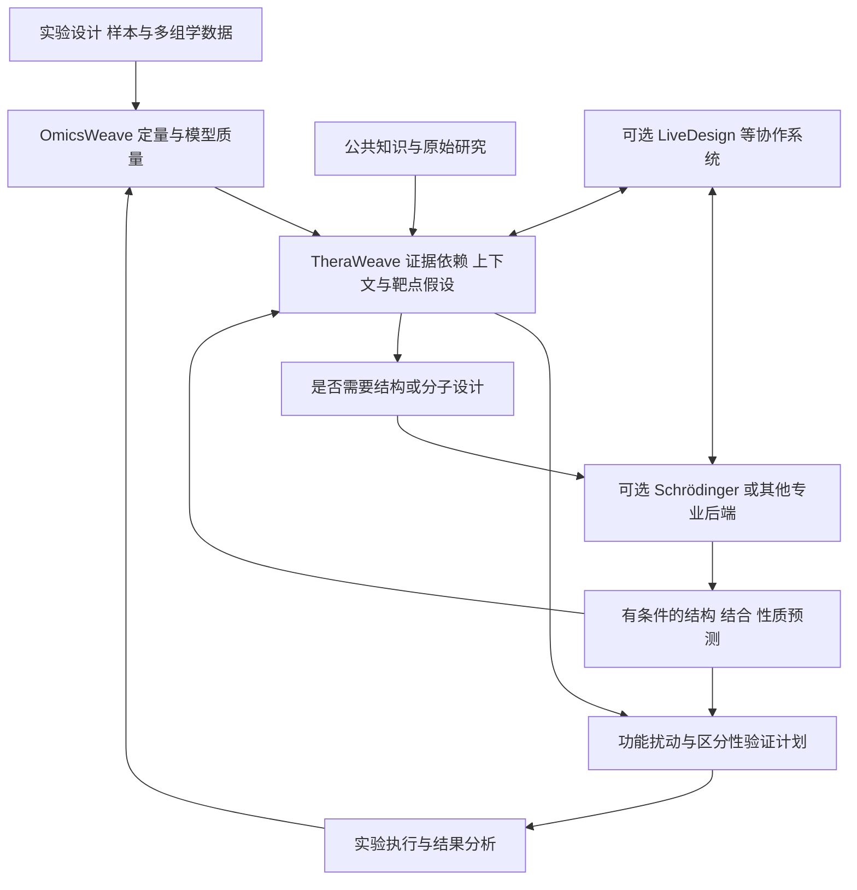

# Schrödinger 与 OmicsWeave × TheraWeave：生态定位、重叠与对接规划

> **核对日期**：2026-10-30。\
> **比较范围**：将“SDGR 软件套装”理解为 Schrödinger 的生命科学软件生态；SDGR 是公司股票代码，不是某一个固定软件包名称。具体授权产品、部署和接口范围需按实际采购/安装核对。\
> **项目范围**：OmicsWeave、TheraWeave 及其接入的公共知识/科学计算工具；不据此扩大到其他仓库或要求部署商业软件。\
> **证据边界**：Schrödinger 能力来自官方产品说明和公告，说明其公开定位，不构成本项目完成的独立性能评测。TheraWeave 现状来自本地代码与已有验收记录；新接口仍属规划。本文未执行 Schrödinger 计算、购买授权或提交任何真实课题数据。

## 1. 定位结论

**建议把 OmicsWeave × TheraWeave 定位为：面向具体疾病与实验上下文，保留多组学、代谢通量和证据依赖语义，帮助选择值得验证的生物学靶点、干预方向与下一项实验。**

Schrödinger 的突出能力是围绕分子结构、相互作用与理化性质，开展靶点结构研究、命中发现、分子/生物药设计与优化，并通过企业平台整合预测和实验。双方在靶点评估、候选选择、数据整合和实验反馈上有交集；区别主要是**决策问题、基本对象和证据尺度**，而不是把整个研发流程切成互不重叠的上下游。

对本项目而言，值得建立并验证的能力是：把“该靶点在这个模型中为何值得干预、方向依据是否充分、哪个实验最能区分替代解释”说明白，再根据研究需要接入专业分子设计工具。该定位是研发策略，尚未证明本项目在真实研究中优于现有平台。

## 2. Schrödinger 当前公开能力不能被简化为分子对接

| 产品/能力 | 官方公开侧重点 | 与本项目的关系 |
|---|---|---|
| Maestro | 分子建模与结果分析的统一工作环境 | 可作为后续结构研究工作台；TheraWeave 不需要重建三维建模 GUI |
| SiteMap、靶点结构研究 | 结合口袋、可干预性及结构适配 | 与 TheraWeave 的可干预性维度重叠，但结构口袋与疾病中的因果作用是不同证据 |
| Glide | 配体—受体构象预测、对接与虚拟筛选 | 可帮助挑选结合线索或实验工具；对接分不直接提供体内功能方向 |
| FEP+ | 自由能计算；包括结合及相关性质问题，也延伸到蛋白/多肽工程 | 适合明确分子体系与问题后的专用预测；不能把一项自由能指标解释成整个治疗假设的成功概率 |
| Desmond | 分子动力学、分子体系构象与相互作用分析 | 与代谢通量分析属于不同尺度的模型，不能因都叫“模拟”而互相替代 |
| BioLuminate | 蛋白与抗体建模、工程及候选性质分析 | 生物药设计已有明显交集；“支持多种治疗模态”不足以构成独有卖点 |
| LiveDesign | 集中计算和实验数据、协作设计、候选与决策追踪，并提供集成机制 | 与研究闭环和决策记录直接重叠；TheraWeave 应集中于假设证据与实验语义，避免重建完整企业信息系统 |
| Bunsen | 基于 Schrödinger 平台规划、执行和解释分子发现工作流的 AI co-scientist | “AI 编排工具”也不是空白领域；本项目可选择外部助手，但证据判断必须可独立重放 |

上述产品范围分别见官方 [Maestro](https://www.schrodinger.com/platform/products/maestro/)、[SiteMap](https://www.schrodinger.com/platform/products/sitemap/)、[Glide](https://www.schrodinger.com/platform/products/glide/)、[FEP+](https://www.schrodinger.com/platform/products/fep/)、[Desmond](https://www.schrodinger.com/platform/products/desmond/)、[BioLuminate](https://www.schrodinger.com/platform/products/bioluminate/) 和 [LiveDesign](https://www.schrodinger.com/platform/products/livedesign/) 说明。Schrödinger 的 [Structure Prediction & Target Enablement](https://www.schrodinger.com/life-science/solutions/structure-prediction-and-target-enablement/) 也覆盖早期靶点结构研究，因此不能断言它只在靶点完全验证后才参与。

Bunsen 的 [2026-07-27 官方公告](https://ir.schrodinger.com/press-releases/news-details/2026/Schrdinger-Introduces-Bunsen-an-AI-Co-Scientist-for-Molecular-Discovery/default.aspx) 明确为 early access；[产品页](https://www.schrodinger.com/platform/products/bunsen/)仍有访问申请。本文不把公告中的能力或访问状态扩大为任何使用者都已具备的完整授权。

## 3. 侧重点比较

| 维度 | Schrödinger 生命科学生态的主要侧重点 | OmicsWeave × TheraWeave 的规划侧重点 | 当前本项目的边界 |
|---|---|---|---|
| 首要问题 | 什么结构/分子方案值得计算、合成和优化 | 哪个生物学假设值得验证，作用方向和关键实验是什么 | 已有规则预览；真实有效性未验收 |
| 基本对象 | 分子、蛋白构建体、序列变体、复合物、计算与 assay | 受试对象、样本、比较、反应通量、证据、上下文限定的靶点假设 | 现有导入仍受上游 0.1 草案限制 |
| 主要输入 | 结构、序列、化合物、实验性质和设计项目数据 | 组学统计结果、实验设计、MFA 模型质量、外部机制及扰动证据 | 本地适配与合成样例已运行 |
| 主要输出 | 结构/结合/性质预测、候选分子或变体及设计优先级 | 证据档案、竞争解释、验证优先级、实验计划与反馈 | 无真实靶点成功概率 |
| 模型尺度 | 原子/分子层面的物理与统计模型 | 动物/供体—组织/细胞—通路/反应—干预假设的证据整合 | 原始 flux/MID、完整 GPR 解释仍待接入 |
| “靶点好不好” | 结构适配、口袋与分子可优化性等 | 疾病相关性、方向、组织、证据独立性、可验证性与转化缺口 | 不声称拥有经过校准的因果评分 |
| 闭环 | 分子设计—计算—合成/测试—分析的迭代 | 观察—假设—区分性实验—结果—假设版本更新 | 计划/审查/反馈已有代码；真实实验尚未回流 |
| 多模态 | 已有小分子、生物药、多肽和核酸相关建模能力 | 比较干预机制、方向、递送条件与实验可行性，再调用专用工具 | 完整模态决策与设计适配器尚未完成 |
| 复现与部署 | 商业产品与企业集成，具体范围随产品与授权核对 | 开放文件契约、BSD-3-Clause 代码、本地默认运行、规则与来源指纹 | 代码许可不替代数据库、商业后端和算力成本 |
| 成熟度 | 已有产品文档、工业工作流与公开案例 | 新建科研软件生态，先证明具体研究场景的价值 | 工程测试与合成往返不能替代科学基准 |

此表是基于公开资料与本地现状作的定位判断，不是双方全部功能的清单，也不是算法性能排序。

## 4. 相同之处与不能使用的差异化说法

双方都重视数据整合、可审查的决策、不同方法协作、候选优先级和实验反馈。本项目可以学习 LiveDesign 对计算与实验衔接、BioLuminate 对模态特有问题和 Schrödinger 对专用方法验证的处理方式。

以下表述不应成为 README、论文或产品介绍的主张：

- “Schrödinger 只做 docking，本项目首次形成完整发现闭环”。其结构研究、自由能、生物药和企业协作能力已有公开说明。
- “只有本项目能做多模态、靶点优先级、可解释结果或 AI 科学助手”。这些类别已有多种工具，必须落实到具体场景和可测的改进。
- “公开数据库叠加一个分数就是独有靶点发现算法”。知识覆盖、去重、规则与效用需要分别验证。
- “MFA 比 MD 更接近真实，所以天然更可靠”。二者回答不同问题，各自受模型与实验条件约束。
- “本地运行必然比商业软件更保密”或“商业平台全部要求把数据上传云端”。需要核对具体部署与访问配置；本项目的可证明特性是默认不发网络请求。
- “开源软件等于整套研究免费”。第三方数据、商业计算、算力、维护及湿实验均有独立条件和成本。

建议对外采用可检查的定位句：**TheraWeave 组织疾病与实验上下文中的多组学证据、依赖和冲突，形成可追溯的靶点验证决定，并可选地衔接专业分子设计平台。** 当前应附“研究预览，真实场景效用待验证”。

## 5. 更接近本项目的重叠生态

差异化评估不能只以 Schrödinger 为参照。组学解释、网络机制与靶点优先级工具更直接重叠：

| 类别/例子 | 与本项目重叠在哪里 | 本项目需要证明的增量 |
|---|---|---|
| Open Targets | 靶点—疾病证据与多维靶点属性 | 本研究的样本、比较、证据依赖和实验决策；不能只复现其汇总视图 |
| QIAGEN IPA | 上游调控、机制网络、表型及比较分析 | MFA 特有语义、真实研究的推理边界、可移交的验证计划及阴性/不确定反馈 |
| Cortellis Pathfinder / MetaCore 体系 | 多组学解释、通路/网络、目标/标志物及机制假设 | 可复现的上下文与依赖处理、具体代谢病场景的增量效用；“组学到假设”本身已存在 |
| Reactome、UniProt、ChEMBL 等公共资源 | 通路、实体、功能和药理信息 | 来源可追溯和正确整合；资源原有内容不算本项目产生的证据 |
| 上游统计/MFA/多组学算法 | 定量结果、模型与候选机制 | 保留各方法的正确语义并服务验证，避免重复造全部分析算法 |

Open Targets 官方将优先级属性分成多类，见[其说明](https://platform-docs.opentargets.org/web-interface/target-prioritisation)。IPA 官方已有[机制、调控与比较分析](https://www.qiagen.com/us/products/discovery-and-translational-research/next-generation-sequencing/informatics-and-data/interpretation-content-databases/ingenuity-pathway-analysis)。Clarivate 的[官方 Pathfinder 页面](https://clarivate.com/life-sciences-healthcare/research-development/discovery-development/cortellis-pathfinder/)明确描述多组学到可解释假设；该页正文直接读取受限，本次使用官方检索文本核对定位，未验证其实际安装或性能。

商业对照只在具备适用授权和可比输入时执行。没有授权时，可先比较公开数据、Open Targets 视图、本项目简单基线和人工审查；不能因无法运行商业工具而宣称胜过它们。

## 6. 生态分工与双向回流

专业结构结果可以在功能验证之前帮助判断口袋、寻找工具或排除不适用方案，功能证据也能指导结构计算。先后顺序取决于问题，不设“一切必须先做完动物验证再做结构”的硬门槛。

TheraWeave 应保存研究假设及其依据；外部平台保留适合自身的数据管理和分子设计职责。若以后实验室已有 LiveDesign/ELN/LIMS，优先交换关联 ID 与必要记录，避免同时维护两个互相冲突的权威实验记录系统。

## 7. 在当前代谢病研究方向中的实际意义

对 HFD/LFD、已知药物和不同处理时长的研究，近期最有价值的问题包括：

1. 哪些组学/通量变化与疾病表型同现，哪些可能只是摄食、体重、时间、组织组成或代偿的结果？
2. 哪些反应及相关酶值得验证，现有数据能否支持作用方向，是否需要独立扰动与救援？
3. 不同疗程、不同药物和不同饮食背景的差异，是否由可估计的对比/交互支持？
4. 哪个功能实验最能区分机制与替代解释，读数是否需要通量、酶活或独立疾病表型？

这是 OmicsWeave × TheraWeave 的近期主线。若随后需要一个选择性工具来干预候选酶，结构可干预性、对接或自由能计算才成为明确的可选任务。没有合适的分子结构任务时，不能为了体现“药物发现”而自动启动大规模筛选。

**分子结合、分子功能、组织作用和体内表型分别建证据。** 一个候选结合分子或稳定复合物可以支持后续实验的设计，不能直接证明其改善肥胖或脂肪肝、证明某组学变化介导疗效，或从两种不同方案的差异中分离出单一受体贡献。以上是本项目对推断范围的要求，不是对商业工具能力缺失的判断。

本节使用一般研究场景说明分工；真实课题的剂量、组别和未发表信息仍保存在本地工作区。

## 8. 对现有规划的具体调整

| 决定 | 调整内容 | 阶段与验收 |
|---|---|---|
| 保留核心 | 多组学/MFA 语义、方向与上下文、来源依赖、冲突、可否证计划和反馈 | T1 优先在真实课题验收；不以“功能列表更长”作为成功标准 |
| 优先补齐 | 完整实验设计、身份/同源/GPR 映射、真实知识覆盖、独立验证与成本记录 | 当前预览的主要缺口，优先于接入更多分子设计后端 |
| 复用专业方法 | 结构准备、对接、MD、FEP、生物药工程等使用可选适配器 | T2；每个适配器有明确问题、输入条件、资源预算及专属验证 |
| 暂缓平台扩张 | 企业协作 UI、通用 AI 科学助手、分子生成和所有模态同时落地 | 由实际研究瓶颈决定，不进入首版必需依赖 |
| 修正差异化主张 | 从“全流程/多模态/可解释”改为具体代谢病证据问题及可验证收益 | README、设计评审、论文和报告保持一致 |
| 增加对照 | 公开/人工基线、知识单源、MFA 消融；具备条件时再加入 IPA/Pathfinder 等可比工作流 | T1/T3；预先定义标签、同样的数据访问范围和计算成本 |

本次新增的是定位和后续设计要求；没有实现 Schrödinger 适配器，也不把其许可证或计算环境加入基础安装。

### 8.1 T2 外部计算接口的最小设计要求

优先支持人工审查后的文件交接，再按真实部署验证本地命令或 API；不预设所有 Schrödinger 产品共享同一个可用接口。可考虑 JSON/CSV 的元数据、SDF/SMILES 的小分子与 PDB/mmCIF/FASTA 的生物大分子表示，具体导出能力、修饰和格式转换由适配器验证。专有格式使用条件单独记录。

| 对象 | 必须携带的信息 |
|---|---|
| 外部请求 | request_id、hypothesis_id/version、context_id、科学问题、任务类型、允许支持的结论、输入摘要与使用者审查 |
| 靶点表示 | 物种、命名空间、序列/同工型、构建体/结构域、突变、结构来源/版本、状态与重要准备假设 |
| 分子/变体表示 | 稳定 ID、立体化学/修饰、结构内容摘要；不能只用模糊名称或未审查的同源映射 |
| 运行来源 | 工具/版本、参数、必要模型/力场/环境、运行与任务 ID、失败/告警、实际资源和时间 |
| 结果 | 预测类型、数值/单位、优劣方向、不确定性及其方法、适用域、对照/参照对象、原始产物摘要 |
| 证据回流 | 保持 inferred/predicted 层级、derived_from 引用、同一输入/计算家族依赖，不覆盖原始观察或复制成多次独立支持 |

对接分数、结合自由能/相对变化、实验 Kd/Ki/IC50、酶活、代谢通量和表型效应不是同一变量；按所用方法定义处理，不强制统一成一个分数。FEP 还需区分绝对/相对任务及参照体系；MD 记录构象与采样条件，其时间序列不等于新的生物学重复。

这些字段属于拟议的外部计算接口，不是本次声称已发布的 OmicsWeave v1 或现有 TheraWeave 0.1 结果格式。命令/API 执行、数据发送和有费用的任务另按使用者授权运行；规划本身不触发计算。

### 8.2 进入专业后端前的判断

- 结构/分子任务能解决哪一个已经登记的证据缺口？没有明确任务则继续生物学验证或补数据。
- 输入的实体、物种、构建体和分子身份是否可靠，所需比较是否处于方法适用范围？
- 当前最合理的干预是否需要小分子/蛋白设计，还是可用现成工具或其他可行扰动先回答机制问题？
- 预测将怎样被实验确认，失败与不确定结果怎样回流？
- 许可、实际安装、运行资源和允许的数据边界是否可用？

这里的判断不要求先把因果证据“全部补齐”，但要求把研究性预测和已验证结论分开。

## 9. 价值与质量应怎样验证

1. **科学效用**：预先冻结候选和理由，记录后续独立功能实验中技术有效、支持、不支持和不确定的数量与效应区间；避免只统计成功样本。
2. **MFA 的增量**：同一可比研究中对照有/无 MFA 的方案，检查其是否改变可检验机制、减少映射歧义或改善后续验证；不把增加一层数据本身当成算法优势。
3. **证据纪律**：数据库转载或派生分析不增加独立支持，缺失/阴性/失败有区别，方向冲突和风险不被高分覆盖。
4. **决策成本**：记录每个被解决的关键假设所需实验、时间和成本，和人工/简单基线比较；目前不能预先承诺减少多少实验。
5. **真实对照**：在相同输入、标签截止时间、知识访问和专家审查条件下评价；商业工具的宣传结果不作为直接可比基准。
6. **后端专属验证**：若加入对接、自由能或生物药预测，以匹配该任务的实验/基准评估，分别报告它们的性能与适用域，不换算成治疗靶点总体准确率。

所有当前实现与后续科学验收仍以[实施记录](implementation_status.md)为准。本轮修改文档和规划，既有 59 项测试是此前代码版本的工程证据；本文不新增一项商业软件比较实验或真实靶点验证。
