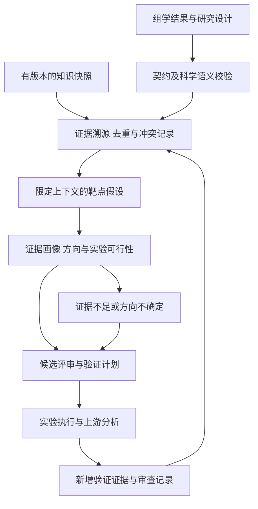

# TheraWeave 设计评审与首版实施规格

> **版本**：v0.2 设计提案，2026-10-30；增加与成熟软件生态的定位约束。本文不是已发布的数据契约，也不代表全部功能已实现。\
> **评审对象**：[OmicsWeave × TheraWeave 总纲](omicsweave_theraweave_development_plan.md)的 v1.1 原稿，科学评审形成 v1.2；随后生态定位评审形成 v1.3，详见[比较文档](schrodinger_ecosystem_comparison.md)。\
> **已确认范围**：代谢性疾病优先，小鼠与人，重点支持代谢酶、转运体及相关调控靶点；保留跨疾病、跨组学扩展接口。此范围于本次评审由项目负责人确认。\
> **初次评审核验范围**：当时仓库仅有 README 和规划，无实现；配套 v2 文档未随仓库提供。评审后的追加实施已检查本机上游 v2.1/0.1 草案源码并建立导入预览，最新事实见 [实施记录](implementation_status.md)；真实研究数据和远端 CI 仍未验证。\
> **文档关系**：总纲规定两个仓库的边界，本文细化 TheraWeave 的科学语义、最小契约需求和验收标准。字段变更须在 OmicsWeave 的契约唯一来源中落实并发布，不能由下游副本自行定义已生效的交换格式。

## 1. 评审结论与优先修改项

**总体设计合理，建议保留架构并收紧首版范围。** 双仓库、结构化结果包、测量与假设分层、默认本地知识快照、可审查的验证计划，均契合“组学结果服务后续实验”的目标。主要不足是科学判断尚停留在原则层面：字段具备了，但其组合何时足以支持某个结论、证据如何去重、缺失如何处理、排序如何验收，还没有明确规则。

首版应定位为 **“研究场景限定的靶点证据评估与验证实验决策包”**。最有价值的交付不是一张基因排行榜，而是：为什么研究这个靶点、考虑何种作用方向、哪些证据相互独立、关键替代解释是什么、下一项实验如何区分这些解释。

该定位与已有组学解释、靶点知识及企业发现平台存在交集；必须通过具体研究中的效用证明增量。与 Schrödinger 的关系是按科学问题互补并允许双向回流，T1 优先验证证据与实验决策，T2 按需复用专业结构/分子计算。不能仅以多模态、闭环、可解释或 AI 编排宣称独有能力。

| 优先级 | 原稿位置与问题 | 建议修改 | 可检查的完成条件 |
|---|---|---|---|
| P0 | §3.3、§6.4：证据维度存在，但没有依赖关系与去重规则 | 增加原始研究、样本重叠、派生关系和证据家族 | 同一结果从两个数据库导入、或从基因扩展到通路后，独立支持数不增加 |
| P0 | §2.3：以反向变化定义“治疗逆转”，且称其最有价值 | 区分方向相反、趋近健康、恢复正常和介导疗效 | 三组方向相反数据不能自动生成“恢复正常”或“抑制该基因有效” |
| P0 | §3.3：缺失、阴性与统计方向的枚举混用 | 数值字段使用数值或 null；分析状态、结果解释、证据立场分别记录 | p > 0.05 不自动成为无效或反对证据；查询失败不成为“无记录” |
| P0 | §3.4、§6.4：以靶点为中心，研究问题上下文不完整 | 增加疾病/表型、预期终点、作用方向、组织/细胞、物种和阶段 | 同一基因在不同组织、疾病和干预方向下形成不同假设 |
| P0 | §5.1：把 JSON Schema 视为完整结果包校验器 | 增加 Arrow 表结构、跨表语义规则、能力声明和失败样例 | 文件损坏、悬空引用、单位冲突、未知必需能力均产生可定位错误 |
| P0 | §3.1、§6.1：MFA 到靶点缺少反应映射与控制关系约束 | 增加 GPR、区室、模型来源和可辨识性规则 | 通量变化只产生相关反应/酶候选，不自动指定限速酶或干预方向 |
| P1 | §6.4：多维评估仍缺少可执行决策规则 | 采用证据画像、显式门槛、分桶和敏感性分析 | 缺失安全性、方向冲突等不能被其他高分抵消 |
| P1 | §6.3：列有抗体和基因治疗，但模态目录不完整 | 拆分作用方向、干预机制、分子模态、递送与实验工具 | RNA 降低表达、mRNA 补充、基因补充和 DNA 编辑分别记录 |
| P1 | §6.5：三个数据库的不同来源可能重复表达同一研究 | 采用证据级记录，保留来源链、查询范围和快照版本 | Open Targets 汇总分不与其底层 ChEMBL/文献记录再次相加 |
| P1 | §8：实验反馈放到 T2，评估放到 T3，MVP 闭环不足 | 将最小反馈模型、基准与防泄漏检查前移到 T1 | 首版可以回收支持、不支持和不确定结果，并保留历史决定 |
| P1 | §8：8–10 周覆盖过多模块，依赖完整 O2 | 分解 T1a/T1b/T1c，先冻结最小导入 profile | 每个子阶段有独立产物；工期由首个真实结果包试运行后重估 |
| P2 | 图数据库、分子生成、多模态设计工具、集群服务 | 保留接口，按实验需求逐项增加 | 核心排序和实验闭环稳定后才扩大运行依赖 |

P0 表示进入契约冻结前应明确；P1 表示公开首版前应完成；P2 表示后续能力。这里的优先级是本次设计建议，不是已完成状态。

## 2. 研究问题与最小工作闭环

### 2.1 决策单位

评估的基本单位应为 `TargetHypothesis`，即：

**靶点实体 × 疾病/表型 × 干预方向 × 组织/细胞 × 生物模型/阶段 × 目标终点**。

例如，“在某代谢病模型的特定肝细胞中降低某酶活性，能否改善预先指定的代谢表型，同时保留细胞功能”是可检验问题。“这个酶在差异表中排名第 1”不是完整的治疗假设。细胞分辨率未知时明确保留未知，不用 bulk RNA 或组织表达图谱替代细胞特异性验证。

`ResearchContext` 至少包含 `context_id`、`disease_or_phenotype_id`、`model_description`、`source_taxon_id`、`intended_taxon_id`、`sample_tissue`、`proposed_target_tissue`、`cell_type`、`sex`、`age_or_stage`、`diet_or_nutritional_state`、`sampling_time`、`primary_endpoint`、`desired_endpoint_direction` 和 `intended_use`。未知项可为空，但须显示其对结论的限制。自定义模型名可以使用项目命名空间，不能伪装成已映射的 MONDO/EFO 术语。

### 2.2 首版输入、输出和职责

- **输入**：上游统计结果、研究设计、可用的样本/受试对象溯源、实体和映射、已有证据，以及用户声明的研究目标。允许单组学、未配对组学和只有候选列表的输入，分别报告能力限制。
- **核心工作**：校验 → 标准化和溯源 → 合并可比证据 → 识别机制及方向缺口 → 比较可验证性 → 生成实验决策包。
- **输出**：每条假设的证据档案、分维度评估、选择/暂缓理由、实验工具线索、验证计划和可回流的实验记录。
- **上游职责**：原始数据处理、差异检验、富集、多组学统计模型和 MFA 拟合。TheraWeave 可请求重新分析，不能悄悄在下游换统计方法或重算上游显著性。
- **首版边界**：以离线 CLI 和静态 HTML 为主；不依赖 LLM、图数据库服务、GPU、分子生成或云计算才能运行。



## 3. 必须补齐的科学语义

### 3.1 原子证据、依赖关系与冲突

一条 `Evidence` 应描述一个有明确上下文和来源的观察、估计或推断，而不是复制一整份靶点汇总分。

| 字段组 | 建议字段 | 目的 |
|---|---|---|
| 身份 | `evidence_id`、`source_record_id`、`source_name`、`source_release`、`source_record_hash` | 保留原始记录，支持幂等导入 |
| 原始出处 | `publication_ids`、`primary_study_id`、`cohort_id`、`sample_set_id`、`assay_id` | 识别数据库之间的同源证据及研究内重复 |
| 派生关系 | `derived_from_evidence_ids`、`dependency_group_ids`、`overlap_status` | 一条证据可以同时具有研究、样本和算法上的依赖 |
| 断言 | `subject_id`、`predicate`、`object_id`、`context_id`、`contrast_id` | 区分实体关联与“某干预改善终点”的断言 |
| 生成方式 | `evidence_level`、`measurement_basis`、`method`、`method_version` | `measurement_basis` 区分 measured / estimated / predicted / curated |
| 统计 | `effect_type`、`effect_value`、`unit`、`ci_lower`、`ci_upper`、`p_value`、`adjusted_p_value`、`adjustment_method`、`test_family_id`、`n_tested` | 保留量纲与多重检验范围；不直接相加不同单位的效应 |
| 样本与质量 | `n_bio_by_group`、`n_pairs`、`experimental_unit`、`qc_status`、`limitations` | 显式区分动物、供体、技术复孔和重复拟合 |
| 与假设的关系 | `hypothesis_id`、`stance`、`stance_reason` | `stance` 为 supports / contradicts / neutral / unclear |

实施规则：

1. 完全重复的源记录合并为一条证据并保留多个导入出处；不同独立实验不能仅因同属一篇论文而删除。
2. 同一批动物的 RNA、蛋白与通量是互补测量，不能计成三次独立生物学复现。富集、网络传播和基因打分若源自同一差异表，也属于派生解释。
3. Open Targets 的聚合关联及其底层 ChEMBL/文献证据保留父子关系，不能作为独立支持再计一次。无法判定样本重叠时标记 `unknown`，不默认独立。
4. 保留各条冲突记录，先检查疾病、组织、时间、物种、剂量和方法是否可比，再判断是否构成真正矛盾。
5. 独立证据组是保守的汇总单位，不是“组内全部删除”。同组不同测量仍展示；每个维度如何取代表值/最高质量证据必须由版本化规则定义，禁止默认为累加票数。

Open Targets 已区分疾病关联证据与靶点本身的可干预性等属性。TheraWeave 应借鉴这种分离，并增加本研究的来源去重和上下文判断，而不把平台分数解释成成药成功概率。[Open Targets 官方说明](https://platform-docs.opentargets.org/web-interface/target-prioritisation)

### 3.2 缺失、阴性与“没有证据”

建议把原稿混合状态拆为正交字段：

| 字段 | 受控值 | 说明 |
|---|---|---|
| `availability_status` | available / not_provided / not_applicable | 该信息是否提供；数值缺失保持 null |
| `analysis_status` | completed / not_analyzed / failed | 是否完成方法执行 |
| `result_interpretation` | detected / not_detected / inconclusive / not_applicable | 解释需结合检出能力、置信区间和方法假设 |
| `stance` | supports / contradicts / neutral / unclear | 只针对明确的假设，不从 p 值自动生成 |
| 知识查询 `lookup_status` | found / no_record_in_snapshot / not_queried / failed | “快照内无记录”必须附查询范围和版本 |

`effect_direction=none` 不能简单由 p > 0.05 得到；效应估计的符号、区间、是否达到检测阈值分别存储。“不支持”也不自动等于“已经证伪”：成功扰动、适合的模型与足够精度都是解释前提。只有有针对性的等效性检验或预定义排除界限，才能支持排除某种大小的效应。

原稿的 `evidence_status` 混合了来源类型、假设与验证结论。新契约应以 `evidence_level`、`measurement_basis`、来源字段和假设特异的 `stance` 为核心；迁移旧值时保留 `legacy_values` 和转换记录，不把 `literature_supported` 当作普遍高质量。

### 3.3 “治疗逆转”需要分层描述

设健康对照为 C，疾病对照为 D，疾病加治疗为 DT。`D−C` 与 `DT−D` 符号相反，最多支持**方向相反的治疗响应**。它不能单独区分部分恢复、过度纠正、非特异毒性、疾病代偿被压制或细胞组成变化。

建议使用独立 `ReversalAssessment`：

- `disease_contrast_id`、`treatment_contrast_id`、`comparator_alignment`、`shared_subjects_or_controls`、`effect_scale`；
- `status`：not_assessed / opposite_direction / towards_reference_supported / discordant / inconclusive；
- `residual_contrast_id`：若可估计，指向 DT 对 C 的剩余差异；
- `phenotype_response_evidence_ids`：疾病相关终点是否改善，不能由分子信号自身循环证明；
- `method`、不确定性、适用条件及 `evidence_refs`。

若两个对比共享对照，估计误差相关；只有在量纲和模型一致时才能组合对比，并保留协方差或由上游共同模型直接估计。`DT−C` 不显著也不等于恢复正常；声称恢复须定义参照范围或等效界限。避免用接近零的疾病效应作分母生成“逆转百分比”。健康加治疗组有助于区分疾病特异作用与一般药物效应，按研究问题规划，不将其强制应用于所有数据集。

代谢病模型需特别记录摄食量、体重变化、禁食状态、昼夜时间和采样组织组成。配对喂养等对照按待检验机制选择；体重可能是干预作用的中介，不能一律作为需要“校正掉”的混杂因素。主分析与敏感性分析应先定义各自的因果问题。

### 3.4 干预方向不能由表达符号推导

拆分以下概念：

| 概念 | 示例 | 来源 |
|---|---|---|
| 观测方向 `effect_direction` | up / down / mixed / none / not_applicable | 原始统计结果 |
| 期望功能方向 `intervention_direction` | inhibit / activate / restore / unknown | 假设层，有上下文和依据 |
| 具体干预机制 `intervention_strategy` | receptor_antagonism、RNA_knockdown、gene_supplementation、gene_editing | 方案层 |
| 分子模态 `modality` | small_molecule、antibody、peptide、siRNA、ASO、mRNA、gene_delivery、DNA_editing | 方案层 |

原枚举的 `edit` 不属于作用方向；`replace` 的意图须解释为恢复哪种功能。新契约发布前可重整枚举；已有文件的迁移必须显式进行，无法明确转换的方向保留 `unknown`。

方向依据优先检查：同疾病/组织的功能扰动、明确功能后果的遗传变异、可解释的分子 QTL 与疾病证据、可靠的药理机制；差异表达和反向响应只形成待检验线索。存在支持与反对两个方向的证据时，生成两条竞争假设或标记 `conflicting`，不能取平均后给出方向。

人类遗传学可提高靶点选择的依据质量，但群体层面的成功关联不能直接变成单个候选的成功概率。[Minikel et al., 2024，原始研究](https://pmc.ncbi.nlm.nih.gov/articles/PMC11096124/) 对作用方向的预测也仍有误差，需要与功能验证区分。[2025 年方向预测原始研究](https://pmc.ncbi.nlm.nih.gov/articles/PMC12488494/)

**首版只需能导入遗传证据，不必自建完整 GWAS/MR 平台。** 遗传证据适配器应保留位点到基因的映射依据、等位基因方向、祖源、基因组版本、组织和效应终点；最近基因不是默认因果靶点。QTL/GWAS 共定位、精细定位和 MR 分别记录假设与限制，MR 还需关注工具强度、水平多效性、样本重叠与方向性。共定位支持共享信号，不能单独证明表达介导疾病；弱证据不等于两个信号不同。[Giambartolomei et al., 2014，方法原文](https://pmc.ncbi.nlm.nih.gov/articles/PMC4022491/)

### 3.5 MFA 是特色能力，但不能跳过“通量到靶点”的推理

必须保存 `model_id/version/hash`、反应方程与正方向、区室、净/交换通量类型、单位及归一化分母、置信区间类型、可辨识性、稳态/非稳态条件和模型拟合质量。区分 tracer-supported MFA 估计与 FBA/其他约束模型预测，不能都标成直接测量通量。跨器官或汇总反应不强行映射到某一个组织内单酶。

反应到靶点的映射应支持：

- `AND`：酶复合体亚基共同要求；`OR`：同工酶或替代酶；转运体还需方向和膜区室。
- 一对多映射与证据来源；映射到多个基因不产生多份独立通量证据。
- 代谢物候选注释、异构体、辅因子和反应可逆性；底物/产物丰度与通量不要求简单同向。
- `mapping_only` 与有扰动支持的 `flux_control_supported` 分开。没有控制证据时，输出“与该反应相关的候选酶，需验证”。

GPR 的布尔语义可参考 [COBRApy 官方文档](https://cobrapy.readthedocs.io/en/latest/getting_started.html)。通量受酶、底物、产物和变构调节共同影响；已有研究展示了这种复杂性，但酵母结果不能直接作为小鼠疾病靶点验证。[Hackett et al., 2016，原始研究](https://pmc.ncbi.nlm.nih.gov/articles/PMC5414049/)

### 3.6 统计与样本结构

保留受试对象、实验单位、样本和技术重复的层级；同一动物多组织或多时间点不能作为独立动物。组学不配对时，可以比较研究层面机制，但不能运行或声称样本级相关。QC 失败、缺失模态及不同对比的实际参与样本数必须进入证据档案。

修正原稿的小样本说明：**对于无并列秩、独立两组各 n=3 的精确 Mann–Whitney U 检验，最小双侧 p=2/C(6,3)=0.10，单侧 p=1/C(6,3)=0.05。** 这是该检验在这些条件下的离散分辨率，不是所有统计方法的统一下限。必须记录精确/渐近/置换方法、单双侧和并列秩处理；不能事后为得到显著性而切换检验。[SciPy 官方说明](https://docs.scipy.org/doc/scipy/reference/generated/scipy.stats.mannwhitneyu.html)

跨研究不直接合并 p 值或 z 分数；同单位、同方向定义且上下文可比时才考虑效应量综合，并处理依赖与异质性。`n_omics_concordant`、`n_tissues_concordant` 是描述统计，不能替代有效独立证据数。

## 4. 最小交换契约需求

### 4.1 支持三种输入能力等级

| Profile（建议名称） | 最低内容 | 允许的用途 | 明确限制 |
|---|---|---|---|
| `candidate_list` | 候选实体、物种、来源、研究目标和筛选规则 | 知识补充、证据缺口与实验可行性整理 | 不推断原研究统计强度、背景富集或完整候选空间 |
| `evidence_bundle` | manifest、实体、独立证据、研究/比较/上下文、映射及完整来源引用 | 正式证据评估和假设比较 | 没有样本级数据时，不能重采样个体或估计样本相关性 |
| `analysis_bundle` | 前者加可选上游 L1/L2 数据、QC 和候选生成背景 | 更充分追溯；调用上游进行预设再分析 | 大型矩阵和原始文件不成为下游强制依赖 |

外部 CSV/TSV 只作为适配器入口，导入后转换为受控内部格式并记录列映射；不把它们提升为正式交换标准。普通候选清单不能通过补空字段伪装成高质量 `evidence_bundle`。

### 4.2 冻结前必须向上游提出的字段

| 对象 | 最少补充内容 |
|---|---|
| Manifest | `bundle_id`、版本、profile、`required_capabilities`、文件相对路径/大小/SHA-256、producer、运行状态、各模块状态、注释版本 |
| Study/Contrast | 实验单位、比较分子/分母与 role、子集条件、协变量、配对/重复测量、实际样本数、样本集引用、模型和时间点 |
| Entity/Mapping | 命名空间、taxon、基因组版本（适用时）、旧 ID、映射基数与置信度、protein group、反应/GPR/区室 |
| Evidence | 第 3 节的来源、派生关系、效应与不确定性、质量和缺失语义 |
| Candidate universe | 被测/通过 QC/进入检验/进入候选生成的实体集合或可解析引用；筛选规则和未入选原因 |
| Hypothesis | 上游提出的实体/通路假设及 evidence_refs；治疗方向由下游填写，不回写上游结果 |

候选列表往往经过 FDR 或效应量筛选，仅看入选者会看不到检测范围及未显著者。保留各组学的检测背景、统计检验家族、未入选记录和未解析实体；不要求每个候选都有所有组学证据。不同来源新加入的知识候选使用独立 `discovery_route`，明确其是否在本研究中被测到。

### 4.3 校验必须分四层

1. **封装层**：版本、profile、文件存在及 checksum、运行完成状态、路径限定于结果包内。先支持目录，压缩包支持后再验证解包路径；不加载数据包内可执行代码。
2. **结构层**：JSON Schema 校验 JSON；Arrow/Parquet schema 校验表字段、nullability、列表元素类型、枚举及数值范围。
3. **关系与科学语义层**：主键唯一、外键有效、证据引用存在、派生关系无环、组织/物种符合显式映射关系、对比和单位可比、区间类型有效、技术重复不冒充生物学重复。
4. **用途层**：区分硬错误和科学告警。悬空核心引用使导入失败；缺少遗传学或细胞类型证据可导入，但降低可支持的结论范围。

JSON Schema 描述 JSON 实例，不能自动验证磁盘上的 Parquet 表及所有跨文件语义。这里的多层校验是基于格式能力提出的工程设计。[JSON Schema 规范](https://json-schema.org/specification)、[Arrow Parquet schema 接口](https://arrow.apache.org/docs/python/generated/pyarrow.parquet.read_schema.html)

错误报告至少含 `rule_id`、`severity`、`file`、`row_or_record_id`、`field`、`message`、`suggested_action`。不能只输出一个 ValidationError 栈，也不能把导入失败当空结果继续排名。

### 4.4 发布、兼容与最小样例

契约仍以 OmicsWeave 的模型为唯一来源，但发布物须同时包含 JSON Schema、表结构字典、语义规则说明、正反例和内容摘要。TheraWeave 固定受支持的发布物及摘要，不从主分支自动下载“最新版”，也不依赖 OmicsWeave 的 Python 运行时代码。

语义化版本只是必要条件：新增枚举值、改变默认解释、增加必需能力均可能使旧读取器失效。先检查版本范围，再检查能力声明。未知可选扩展原样保留并告警；未知必需能力或无法解释的方向枚举拒绝进入评估。契约补丁不得悄悄改变科学语义。

共享样例至少涵盖：单组学、缺失模态、研究内多组学相关、同源一对多、未知代谢物、蛋白组歧义、反应 AND/OR、通量不可辨识、方向冲突、正常的空候选、重复证据、悬空引用、损坏 checksum、未知必需能力。每个样例附预期规则 ID 和接受/拒绝结果。

## 5. 证据画像与可解释优先级

### 5.1 分开评估“值得验证”与“可开发治疗”

建议至少输出八个维度：本研究质量、独立重复、机制/因果依据、方向依据、组织与细胞适配、人类转化相关性、干预/实验工具可用性、已知风险。每维含 `status`、`rule_id/version`、支持与反对证据、缺失原因及依据范围。

维度状态建议为 `supported / limited / conflicting / unknown / not_applicable`。同时分别输出 `evidence_coverage` 和 `evidence_strength`：资料多不等于质量高，资料少也不等于低风险。不得将缺失值默认为 0、无风险，或把其余维度重新归一化后使缺信息候选变得更高分。

### 5.2 首版采用规则分桶

以下规则是**待校准的工程政策**，不是已经验证的生物学阈值：

| 决策桶 | 进入条件 | 下一步 |
|---|---|---|
| `functional_validation_ready` | 身份/上下文清楚，本研究或可靠外部证据达到项目质量门槛，至少一项可执行的区分性实验，待评估干预范围无已确认的阻断风险 | 进行限定模型中的功能验证；方向未知时可设计竞争方向实验 |
| `evidence_gap_first` | 假设可解释，但映射、模型适配、检测精度或工具证据不足 | 先补测量/映射/工具验证；列出最可能改变决定的缺口 |
| `conflict_resolution_first` | 可比证据对方向或机制有实质冲突 | 设计区分替代解释的实验 |
| `hold_for_review` | 有具体高风险、关键用途不匹配，或核心解释无法成立 | 人工记录暂缓原因、适用范围和复核条件 |

质量门槛、最低效应、允许的 QC 状态及风险规则写入研究配置并在看最终排序前固定；初期可以保守地输出缺口，而非自动填满 Top 10。普通数据库“必需基因”标签或安全数据缺失只是审查信号，不应直接否决所有局部、短时或部分抑制的实验。

一个研究可采用多条入选路径，例如“单组学高质量＋可检验机制”或“多个互补组学＋明确假设”；不强制所有候选必须有人类遗传支持或三组学一致，否则会系统性漏掉新靶点。

默认展示分桶和证据向量，不提供加和总分。同桶使用预先声明的规则排序，保留并列；稳定 ID 只用于可复现显示，不制造科学差异。若以后提供可配置权重排序，必须作为可选决策视图，展示权重、覆盖率、风险门槛和敏感性，不能回归为唯一总分。

### 5.3 稳健性与解释输出

- 分别移除一个原始研究/证据家族或知识来源，检查候选分桶、方向与关键理由是否改变。
- 对有合理范围的阈值进行预先声明的敏感性分析，保留设定与结果；避免根据喜欢的候选调阈值。
- 只有拥有适当样本数据和上游重分析能力时，才按动物/供体层级 bootstrap；仅有汇总结果则报告该项不可评估。
- 输出“哪些证据导致当前决定”“哪个缺口解决后可能改变决定”，而不是没有出处的自然语言解释。
- 保留所有入选、未入选、暂缓和无法评估的假设及理由；网络传播候选另标为推断，不与直接测量证据混为一类。

## 6. 知识源、模态与实验工具

### 6.1 以本地可复现快照为核心

首批来源仍建议为 Open Targets、UniProt 和 ChEMBL，但应明确分工：

| 来源 | 首版用途 | 不能从中直接推出的结论 |
|---|---|---|
| Open Targets | 疾病关联、底层证据引用、遗传与可干预性等资料 | 关联分不是本实验的因果证据，也不是安全性结论 |
| UniProt | 蛋白身份、功能、亚细胞定位、同工型、物种 | 注释或肝脏表达不证明某递送方式可进入目标细胞 |
| ChEMBL | 已知作用机制、结合/功能测定、实验工具线索 | 结合活性不必然等于功能抑制，体外活性不证明可用于疾病模型 |
| HPA / GTEx / IMPC / MGI | 后续分批加入表达背景、跨组织风险和模型表型 | 全身终生敲除、肿瘤细胞必需性不直接等于成人局部短时干预风险 |
| 外部遗传/扰动研究 | 首版允许人工结构化导入，随后增加适配器 | 没有足够输入时，不伪造共定位/MR/功能验证结果 |

源注册表应记录：release、下载/检索时间、来源 URL、原始许可及核对日期、可否再分发、原文件与派生子集 checksum、适配器版本、实体/字段覆盖、查询过滤条件及使用模式。软件的 BSD-3-Clause 许可不覆盖第三方数据。

不要把全量知识库捆绑进 wheel。采用独立可下载快照或用户本地路径；小型示例使用合成记录或许可允许的公开子集。派生子集保存提取查询与母快照摘要。正式运行默认禁网，知识刷新是显式操作；在线模式需记录发送字段和查询日志，API 失败不回退成“没有证据”。本次评审未下载或重新分发数据库，也未宣称已完成各来源许可审查。

### 6.2 区分实验工具与治疗候选

`InterventionOption` 至少包含 `hypothesis_id`、方向、机制、模态、目标组织/细胞、递送设想、持续时间/可逆性、物种适配、工具身份、作用证据、选择性限制和用途（`research_probe` / `therapeutic_concept`）。

ChEMBL 等来源的工具证据需保留 `assay_type`、`target_type`、`target_taxon_id`、`target_mapping_confidence`、`activity_type`、`relation`、`value`、`unit`、`mechanism_of_action` 和原始来源。Ki、Kd、IC50、EC50 及不同 assay 背景不能无条件混排；细胞毒性或表型测定不能直接充当单一蛋白的结合验证。[ChEMBL 官方 assay 文档](https://chembl.gitbook.io/chembl-interface-documentation/frequently-asked-questions/chembl-data-questions)

对首版，更有价值的是找到可用于验证的、机制清楚的工具及替代手段。完整药物再利用、虚拟筛选和 ADMET 计算留到 T2。已获批药物必须核实直接靶点、方向和适应证；“作用于同一通路”仅是通路线索，不自动升级为再利用候选。

### 6.3 模态适配不是标签匹配

| 模态 | 应检查的条件 | 输出方式 |
|---|---|---|
| 小分子 | 功能方向、有效结合与选择性、细胞/组织暴露 | 适配依据、工具可用性、待验证的功能与暴露问题 |
| 抗体 / 多肽 | 靶位可及性、受体激动/阻断机制、跨物种识别、组织分布 | 分别记录，不能因都是蛋白类就共享全部规则 |
| siRNA / ASO | 目标转录本、作用机制、目标细胞摄取、递送可行性 | 降低 RNA、剪接调节等机制分开；不笼统标成 RNA 抑制 |
| mRNA / 基因补充 | 是否需要恢复功能、表达定位、剂量与持续性 | 功能补充设想，保留过量表达及递送缺口 |
| DNA 编辑 | 变异/调控机制、编辑后的功能方向、递送与持久性 | 编辑属于实现手段，不能替代作用方向证据 |

“肝脏表达”不足以证明肝细胞特定递送可行，更不能代表肝脏全部细胞。模态规则同时处理身份、方向、区室、组织、递送、可逆性和可测性；缺一项则报告待确认条件。首版使用规则和证据解释即可，不需要同时实现每个模态的设计工具。

## 7. 验证实验计划和反馈模型

### 7.1 让每个计划回答一个可否证的问题

`ValidationPlan` 应由明确的竞争解释和证据缺口驱动。建议包含：

| 字段组 | 必要内容 |
|---|---|
| 关联 | `plan_id/version`、`hypothesis_id/version`、`assessment_run_id`、优先解决的 `gap_ids` |
| 问题 | 主要假设、替代解释、预期方向、主要终点和最小有意义效应 |
| 体系 | 物种、组织/细胞、疾病状态、模型适配依据、性别/阶段及关键环境条件 |
| 干预与对照 | 工具及作用方向、载体/vehicle 或非靶向对照、阳性对照（适用时）、正交扰动、救援实验或其不可行说明 |
| 读数链 | 靶点接合/扰动是否成功 → 功能或酶活是否改变 → 相关通量/机制是否改变 → 疾病相关表型是否改善 |
| 非特异效应 | 活性/存活、一般应激、递送/载体效应及其他可解释表型的干扰 |
| 设计 | 实验单位、独立重复、随机化/区组、盲法、排除标准、主要比较、多重检验和缺失处理 |
| 精度/样本量 | 效应与方差依据、alpha/power 或精度目标、配对/聚类结构、脱落假设及敏感性范围 |
| 决策 | 预先定义的推进/暂缓/不确定条件，以及观察到相反结果时如何更新假设 |
| 状态 | draft / reviewed / executed / analyzed / closed，审查人、时间和修改理由 |

独立生物学重复与技术重复明确区分；不要默认每组 n=3。样本量应依据独立先验、先导数据和最低有意义效应，避免直接使用筛选后最大的效应作乐观估算。缺少方差或模型参数时输出待补参数及估算场景，不生成看似精确的样本数。动物实验设计字段可参考 ARRIVE 2.0；它是设计与报告参考，不是算法有效性认证。[ARRIVE 官方指南](https://arriveguidelines.org/arrive-guidelines)

### 7.2 代谢酶候选的示意计划

以下使用虚构酶 A，不涉及具体治疗靶点或实验剂量；它用于说明软件应产生的判断结构。

| 要区分的解释 | 需要的证据/实验 | 结果如何影响下一步 |
|---|---|---|
| A 的变化只是疾病标志，还是功能性环节？ | 在适合模型中改变 A，确认扰动成功，并测独立疾病相关终点 | 只有表达改变而无成功的功能扰动时，不能判定假设无效 |
| 表型来自 A，还是工具脱靶？ | 独立机制的扰动、合适的阴性对照；可行时进行救援 | 正交结果一致并获救援支持时，增强归因；不一致进入冲突审查 |
| A 改变表型是否经过所假定的代谢反应？ | 酶活/功能读数、模型适用的示踪通量与相关代谢物，保留区室信息 | 只观察浓度变化不能确认通量机制；模型不可辨识时先解决测量缺口 |
| 表型改善是否只是毒性或整体代谢抑制？ | 与主要终点同时检查细胞/组织功能和非特异应激 | 若改善伴随明显非特异损害，不能简单记为支持治疗假设 |
| 小鼠结果能否进入人类相关研究？ | 对照同源映射、功能/药理差异，并在适合的人源体系复核 | 证据不足时保留物种特异结论，不直接宣称可转化 |

实验顺序优先选择能区分关键机制、成本适合且可执行的步骤。首版不声称计算精确的“信息增益”，可记录预期会改变哪个决定、成本/周期等级和实验室能力。

### 7.3 阴性和不确定结果也必须回流

最小反馈对象 `ValidationOutcome` 应在 T1 实现，包含计划版本、实际执行偏差、分析包引用、主要终点效应与区间、扰动成功与否、QC、支持范围、结果解释和审查记录。

- `supported`：在本计划条件下支持某项假设，不升级为普遍有效。
- `not_supported`：未达到预定义支持标准，附精度与可排除效应范围；不是全局否证。
- `inconclusive`：扰动失败、模型不适配、精度不足、QC 不合格或结果冲突。
- 明确的 `contradicts` 证据关联到具体断言和上下文，不能因为一个实验未显著就把整个靶点标成 `refuted`。

新结果生成新的证据和评估版本，旧运行、旧判断与人工覆盖理由不可覆盖。人工可调整推进状态，但必须保留原算法建议、操作者、时间、理由与所依据证据。

OmicsWeave 导出模板还需保留 `plan_id`、`hypothesis_id`、`experiment_id`、subject/sample 关联和主要比较。未填写的动物/样本标识、时间与采集信息使模板保持 **draft**；只有补全后通过上游校验，才能称为可执行实验配置。不能把“产生模板”写成“已经通过 OmicsWeave validate”。

## 8. 工程结构与结果包

### 8.1 保持模块小而有边界

建议先采用单 Python 包，按职责分模块；以下为设计结构，不要求一次创建所有目录：

```text
src/theraweave/
  core/                 # 研究上下文、假设和运行标识
  contract/             # 输入适配、结构及语义校验、版本迁移
  knowledge/            # 本地来源注册、快照、按来源划分的适配器
  evidence/             # 证据规范化、来源依赖、去重和冲突
  targets/              # 证据画像、规则分桶、敏感性分析
  modalities/           # 机制及模态规则；首版不装设计模型
  experiment_planning/  # 缺口、计划、审查与反馈
  evaluation/           # 合成反例、独立基准和泄漏检查
  reporting/            # 与正式输出同源的 HTML 视图
  cli.py
```

`core` 不反向依赖具体数据库；`targets` 不直接发网络请求；来源适配器输出同一证据模型。证据图谱先用实体表、关系表和来源边表示；数据规模证明需要后再引入图数据库。可选使用本地查询引擎，但不能把额外服务作为首次安装前提。

安装依赖以数据读取、校验、命令行和报告为限，具体版本在首个实现阶段验证后锁定；RDKit、深度学习、结构和编辑工具使用 extras。Windows/Linux 都需验证；CLI 仍需要已安装的 Python 包或未来独立运行时，文件交换本身并不能让命令行脱离运行时执行。

### 8.2 TheraWeave 必须有自己的评估产物

```text
discovery_results/<project_id>/<assessment_run_id>/
  manifest.json                  # 输入包摘要、软件/规则/快照/配置版本
  context.json
  entities.parquet
  evidence.parquet
  evidence_dependencies.parquet
  hypotheses.json
  target_assessments.parquet
  intervention_options.parquet
  decision_log.json
  sensitivity_results.json
  validation_plans/<plan_id>/
  validation_outcomes.parquet
  reports/decision_report.html
```

正式写出先进入临时运行目录，全部校验完成后发布完整运行状态；失败或中断的目录不能作为已完成输入。对大矩阵可引用校验后的本地上游路径，但最小评估包必须能说明缺失引用对可复现性的影响，并提供允许范围内的归档选项。

报告至少显示：输入质量和覆盖、候选生成范围、每条假设的支持/反对证据、独立来源、方向和模态依据、风险与缺口、选择理由、下一项实验、审查及版本信息。表格和报告共享同一结果对象，文本生成不得另算数值。LLM 将来最多辅助整理文字；没有可验证的证据引用就不能新增科学断言，也不能自动改变等级。

## 9. 评估设计与首版质量门槛

### 9.1 三类评估从 T1 开始

| 层次 | 数据与问题 | 合格含义 |
|---|---|---|
| 工程与逻辑 | 合成正常/反例输入、固定快照、兼容性矩阵 | 解析、去重、状态、规则和报告符合预期；不证明生物学有效 |
| 回顾性科学评估 | 公开或经授权的代谢病研究，事先定义候选空间和参照标签 | 与简单基线比较，报告样本/标签范围和不确定性；不承诺普遍泛化 |
| 前瞻性实验闭环 | 在新实验前冻结候选、理由、计划和判断标准 | 检查后续实验是否能区分假设、修正判断；避免只回报成功候选 |

至少比较：差异表达/效应量简单排序、上游证据画像、单一知识来源基线、TheraWeave 完整规则，以及去掉 MFA 或去掉外部知识的消融。MFA 的增益需在检测范围与模型质量可比的子集中评估，不能用多测了一层组学本身当作算法优势。

### 9.2 防止循环验证和数据泄漏

1. 以原始研究/队列为分组单位拆分，不把同一动物的不同组学分到训练与测试两侧。
2. 用获批靶点或临床进展作参照时，不把同一批准信息、直接药物适应证及其派生汇总分当输入特征；剔除或隔离该信息。
3. 做时间切分时，知识快照及其衍生注释均固定在截止时间；拿不到历史快照就明确只是回顾性重现，不能称为前瞻预测。
4. 同源基因/家族、同一数据集的多篇论文及知识库转载需要泄漏审计；阈值只在开发集选择。
5. “尚未成为已知靶点”属于未标记，不作为真实阴性。临床失败也要区分靶点无效、暴露不足、毒性、试验设计和商业停止等原因。

候选排序可报告有明确标签定义的 `Precision@K`、已知支持项 `Recall@K`、富集及来源分组的不确定性；使用 NDCG 需要事先定义分级标签。对未标记候选很多的数据集，说明指标只是相对已知标签的表现，不声称真实生物学精度。前瞻实验另外报告已尝试数、技术有效数、支持数、不支持数和不确定数，以及耗时/成本与专家审查一致性。

没有独立数据前不设置“准确率达到 90%”等虚构目标。首次真实案例用于确定可达的覆盖、运行时间、内存和数据量预算；记录机器、输入规模、冷/热缓存及数据库版本。

### 9.3 必需的行为验收场景

| 场景 | 预期行为 |
|---|---|
| 同一证据被导入两次 | 结果幂等，独立支持数与优先级不变 |
| 同一批动物增加通路派生结果 | 信息可展示，但不增加独立重复数 |
| 没有蛋白组/遗传学/安全性资料 | 标记覆盖缺口，不生成阴性结论或“低风险” |
| 方向相反但缺健康参照或共享对照信息 | 保留反向响应线索，拒绝自动推断恢复正常和因果性 |
| flux 增加、反应映射到两个同工酶 | 保留 OR 及同一通量来源，不能断言两酶都是应抑制靶点 |
| 未注释代谢峰或歧义 protein group | 保留歧义；不复制成确定的靶点支持 |
| API 中断或知识快照不覆盖该实体 | 区分失败与无记录；离线运行不会偷发请求 |
| 只有候选清单、没有测试背景 | 限制为知识补充与缺口整理，不运行背景富集或声称完整排序性能 |
| 输入有效但候选为空 | 正常输出空候选报告和原因，不误报系统失败 |
| 新验证实验扰动失败 | 回流为 inconclusive，不把假设全局否证 |
| 人工覆盖计算决定 | 保留前后状态、理由、操作者与对应运行版本 |
| 报告与表格比较 | 关键数值、状态、理由和证据引用逐项一致 |
| 导出的实验草稿尚缺样本信息 | 显示 draft 和缺失项，补齐后才进入上游校验 |

## 10. 调整后的实施顺序

| 阶段 | 交付 | 进入下一阶段的条件 |
|---|---|---|
| T0：设计与契约评审 | 本文、最小 profile 字段、标准正反例清单、真实首发场景选择 | 上下游对字段语义和样例预期达成一致；当前仍为文档工作 |
| T1a：导入与证据档案 | 冻结的最小 profile、独立读取器、结构/语义校验、来源去重、只读报告 | 不安装 OmicsWeave 能读取合成及一个真实结果包，科学限制可见 |
| T1b：知识与候选比较 | 三个首批来源的受控本地子集、研究上下文、画像/分桶、工具线索、消融和敏感性 | 同一输入/快照可重现；去重与缺失规则、方向冲突及基线评估通过 |
| T1c：实验闭环 | 验证计划、人工审查、草稿模板、验证结果回流和版本日志 | 一条假设完成导入→计划→模拟反馈；真实数据例另行审查 |
| T2：按需要扩展 | 完整药物再利用、其他模态适配器、更多知识源、专用计算 | 每增加一项能力，都有具体实验需求、依赖预算和独立验收 |
| T3：发布与论文 | 稳定 API、安装/教程、独立科学评估、复现包 | 以工具质量和科学证据为门槛，不要求先做完所有 T2 模态 |

T1 稳定功能以所消费的契约 profile 发布为前提。评审后的实施采用显式启用、固定源码摘要的 0.1 草案兼容预览，详见实施记录。可以推动 O2 先发布最小可消费 profile，再逐项增加组学扩展，不必等到所有组学功能和原始数据适配器完工。本文不声称上游已接受或发布这些字段变化。

原稿 8–10 周应视为未经验证的初估，先根据 T1a 的实际导入难度、知识快照规模和可用湿实验能力重估。单人开发保持一个主要编码阶段；在这一约束下，优先完成从真实结果包到实验计划的一条闭环。

生态比较补充：T2 的专用计算优先采用外部文件交接，保存请求/假设/上下文、物种与构建体、结构和分子身份、方法适用域、指标语义及原始产物。Docking、FEP、MD 或生物药预测结果保持其预测层级，不填补尚缺少的功能与表型验证。T1/T3 的效用对照还需考虑 Open Targets、IPA/Pathfinder 类工作流；具体边界和指标见[生态比较](schrodinger_ecosystem_comparison.md)第 5、8、9 节。这些为规划要求，尚未实现商业后端。

## 11. 已确认范围、建议与仍需落实事项

| 类型 | 内容 |
|---|---|
| 本次已确认 | 代谢性疾病优先，保留通用扩展接口 |
| 继承原设计 | 双仓库、文件契约、Parquet 正式表格、本地快照、多维证据、先研究验证再扩展治疗设计 |
| 本次新增建议 | 假设上下文、依赖去重、方向拆分、多层校验、最小 profile、规则分桶、实验反馈及早期评估 |
| 契约冻结前落实 | 已在追加实施中对照本机上游草案与配套文档；仍需将本文字段需求落实到权威模型并发布样例及语义规则 |
| 首个真实案例前落实 | 选择具体代谢病研究、主要终点、可用组学和实验体系；确认数据授权及本地存储边界 |
| MVP 发布前落实 | 数据源版本和许可核对、Windows/Linux 安装验证、独立评估、项目 LICENSE 与引用信息 |

本文件记录设计评审；其后的实现范围见实施记录。已建立可安装的导入预览，但未生成真实靶点排名、执行组学分析或完成生物学验证。下文来源支持科学和格式判断，字段与工程拆分属于本项目设计建议。

## 12. 核对的主要依据

核对日期：2026-10-30。以下为官方文档或原始研究；网页工具可读性不同，Open Targets 优先级说明使用其官方检索结果核对。本文未进行系统性文献综述，也未验证各方法在本项目数据上的效果。

| 来源 | 本次用于支持的判断 |
|---|---|
| [Open Targets：Target Prioritisation](https://platform-docs.opentargets.org/web-interface/target-prioritisation) | 靶点属性与疾病关联分开看，按多个维度审查 |
| [Minikel et al., Nature 2024](https://pmc.ncbi.nlm.nih.gov/articles/PMC11096124/) | 人类遗传依据与临床成功的关联，及其不能直接转成个体靶点保证 |
| [Genetic evidence informs the direction of therapeutic modulation, 2025](https://pmc.ncbi.nlm.nih.gov/articles/PMC12488494/) | 作用方向是独立问题，预测需要验证 |
| [Giambartolomei et al., PLOS Genetics 2014](https://pmc.ncbi.nlm.nih.gov/articles/PMC4022491/) | 共定位的用途与功效不足的区别 |
| [Hackett et al., Science 2016](https://pmc.ncbi.nlm.nih.gov/articles/PMC5414049/) | 通量调节不能简单等同于酶丰度变化；证据来自酵母，需限制外推 |
| [COBRApy：Getting Started](https://cobrapy.readthedocs.io/en/latest/getting_started.html) | GPR 布尔关系和区室语义 |
| [ChEMBL：Assay and Activity Questions](https://chembl.gitbook.io/chembl-interface-documentation/frequently-asked-questions/chembl-data-questions) | assay 类型、靶点映射置信度、跨物种映射 |
| [ARRIVE 2.0](https://arriveguidelines.org/arrive-guidelines) | 动物实验的设计、样本量、偏倚控制与报告字段 |
| [SciPy：Mann–Whitney U](https://docs.scipy.org/doc/scipy/reference/generated/scipy.stats.mannwhitneyu.html) | 精确/渐近/置换与并列秩条件；n=3 的下限由组合枚举计算 |
| [JSON Schema specification](https://json-schema.org/specification) | JSON 结构校验边界 |
| [Apache Arrow：read_schema](https://arrow.apache.org/docs/python/generated/pyarrow.parquet.read_schema.html) | Parquet 表结构需要独立读取和校验 |
